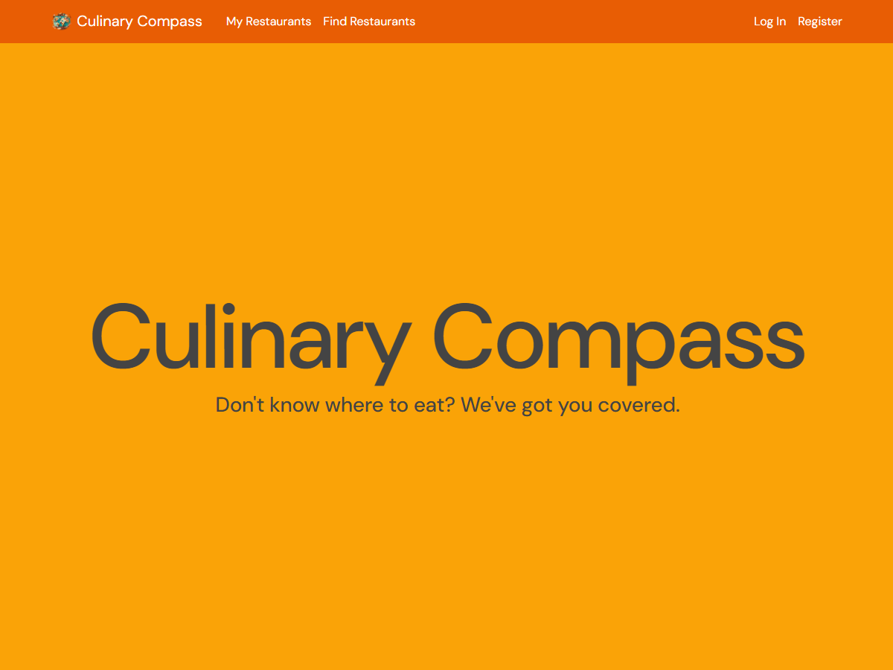

# Culinary Compass

A web app for restaurant tracking and ML-powered recommendations.

Built with Flask, Python, and Bootstrap, Culinary Compass integrates the Google Maps API, Foursquare Places API, Scikit-Learn, ReportLab, and Matplotlib. It is deployed on an Azure Linux VM using Nginx, Gunicorn, and Supervisor, with a PostgreSQL database.

## About

Culinary Compass allows users to track their restaurant visits by inputting the restaurant name, date, and a rating. Autocomplete assists in entering restaurant names, and a user profile is built using the collected data.

Recommendations are generated by comparing nearby restaurants (or restaurants at a user-specified location) to the user profile using a cosine similarity algorithm.

Users can generate a PDF report summarizing their favorite restaurants and dining trends, which is emailed to them.

## Usage

Visit Culinary Compass [here](http://www.culinarycompass.siddhp.com) and follow the tutorial on the home page.

## License

This project is licensed under the MIT License.
